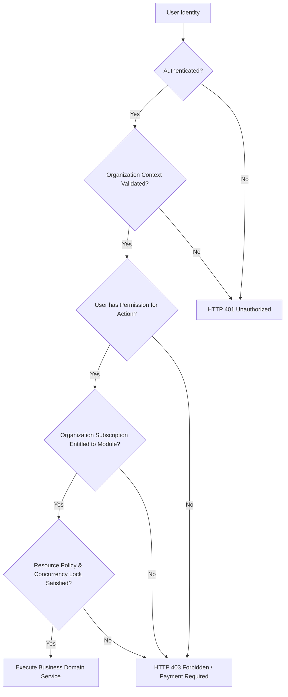

# Solution Architecture — Skyra Business Suite

**Project:** Skyra Business Suite  
**Version:** 1.0  
**Date:** October 16, 2026  
**Auditor Roles:** Principal Enterprise Architect, Solutions Architect  

---

## 1. Architectural Vision & Scope

Skyra Business Suite is a next-generation, multi-tenant commercial SaaS business management platform. It is structured as an **Enterprise Modular Monolith** that provides unified customer onboarding, dynamic plan/module subscription entitlements, and strong tenant data isolation.

---

## 2. Target Technology Stack & Justification

```
┌─────────────────────────────────────────────────────────────────────────────┐
│                       FRONTEND: Angular Zoneless SPA                        │
│   Angular 22.2.x Standalone Components │ Signals Reactive State             │
│   provideExperimentalZonelessChangeDetection() │ Zero Zone.js Overhead      │
│   Tailwind CSS 4.3.x │ Vitest 5.x │ TypeScript ~6.0.2                      │
│   Skyra Platform W3C Custom Elements (<skyra-tech-*>) │ Design Tokens       │
└──────────────────────────────────────┬──────────────────────────────────────┘
                                       │ HTTPS / REST (OpenAPI 3.1)
┌──────────────────────────────────────▼──────────────────────────────────────┐
│                        BACKEND: NestJS Modular API                          │
│   NestJS 12.x REST API (Modular Monolith) │ Strict Dependency Injection     │
│   Node.js 24 LTS (>=24.15.0 <25.0.0) │ TypeScript 6.0.x │ Oxlint            │
│   Express HTTP Transport │ Vitest 4.1.x │ Argon2 / JWT & Cookie Auth        │
│   Global Exception Filters │ Class-Validator / Zod DTO Validation Pipes     │
└──────────────────────────────────────┬──────────────────────────────────────┘
                                       │
┌──────────────────────────────────────▼──────────────────────────────────────┐
│                    PERSISTENCE & EVENT ORCHESTRATION                        │
│   Prisma ORM 6.8.x with Tenant Extension │ PostgreSQL 16+                   │
│   PostgreSQL Shared Database with Row-Level Multi-Tenancy (organizationId)  │
│   BullMQ + Redis for Asynchronous Background Jobs & Event Delivery          │
└─────────────────────────────────────────────────────────────────────────────┘
```

### 2.1 Frontend: Angular Standalone (Zoneless)
* **Zoneless Architecture:** Zone.js monkey-patches browser async APIs, adding 100KB+ to bundle size and introducing subtle state desynchronization bugs. Angular’s native zoneless change detection relies entirely on **Signals**, template events, and reactive primitives.
* **Standalone Components:** All UI screens and widgets are declared with `standalone: true`. No legacy `NgModule` declarations.
* **Lazy Loading:** Every business module (CRM, Billing, Accounting, HR) is lazy-loaded via the Angular Router (`loadChildren: () => import('./...')`).
* **Web Components Integration:** Declaring `CUSTOM_ELEMENTS_SCHEMA` allows direct binding to `@skyra-tech-platform/*` custom elements via native property (`[prop]`) and event (`(customEvent)`) syntax.

### 2.2 Backend: NestJS Modular Monolith
* **Domain Modules:** Structured into decoupled modules (`AuthModule`, `TenancyModule`, `EntitlementsModule`, `CrmModule`, `BillingModule`, `AccountingModule`).
* **Inversion of Control & Dependency Injection:** Enforces separation between HTTP controllers, application services, domain business rules, and database persistence repositories.
* **OpenAPI Documentation:** Built-in `@nestjs/swagger` automatically generates OpenAPI 3.1 specifications directly from annotated DTOs and controller decorators.
* **Security Middleware:** Native integration of Helmet (security headers), CORS policies, rate limiting (`@nestjs/throttler`), and global validation pipes.

### 2.3 Database & Multi-Tenancy Strategy
* **Shared Database with Discriminator (`organizationId`):**
  * All tenant-owned tables carry a mandatory `organizationId String` foreign key.
  * Composite unique constraints ensure tenant-scoped uniqueness (e.g. `@@unique([organizationId, invoiceNumber])`).
  * Prisma Client Extensions (`prisma.$extends`) automatically enforce tenant scoping on read/write queries to prevent accidental developer omission.

---

## 3. Dynamic Module Entitlement & Subscription Architecture

Skyra Business Suite decouples **identity/membership** from **business capability access**:



1. **Identity:** Who the user is (User account).
2. **Organization Context:** Which tenant workspace the user is operating within (`X-Skyra-Org-ID`).
3. **Role & Permission (RBAC):** What actions the user's assigned role allows (e.g., `invoices:write`).
4. **Subscription Entitlement:** Whether the organization has an active commercial plan or add-on covering that module (e.g., `invoicing: true`, `payroll: false`).
5. **Execution:** The action executes only if **all four gates** pass.

---

## 4. MCP (Model Context Protocol) Integration Architecture

To support agentic AI workflows via **Skyra Jarvis** safely:
* A dedicated `McpModule` exposes an authorized JSON-RPC / SSE endpoint.
* **Security Invariant:** MCP tools **never** access the database directly or execute arbitrary SQL.
* Every MCP tool delegates to the exact same NestJS Domain Services used by the REST API, enforcing:
  1. Machine/Agent authentication via scoped, expiring tokens.
  2. Organization tenancy scoping.
  3. RBAC permission checks.
  4. Two-step explicit confirmation for sensitive mutations (creating invoices, voiding documents, recording payments).
  5. Immutable audit logging of every AI action.

---

## 5. Deployment and Operations Topology

* **Phase 0/1 Topology:** Independently deployable containerized units:
  1. `web`: Nginx serving static Angular standalone build assets.
  2. `api`: Node.js container executing NestJS REST API and MCP server.
  3. `postgres`: Managed PostgreSQL instance (AWS RDS / Supabase).
  4. `redis`: Redis cache and BullMQ job broker.
* **Zero Microservices at Inception:** No premature microservices. The modular monolith retains ACID transaction boundaries between billing and the general ledger while allowing eventual extraction of high-scale modules if justified.
